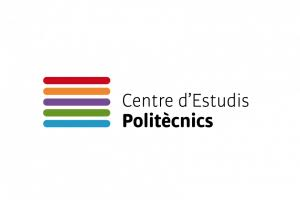

 

  

  

📍 Mataró, Barcelona · Cataluña, España

---

## 🧑‍💻 Sobre mí

<table align="center">
<tr>
<td align="center" width="50%">

### 🔐 Ciberseguridad

Me interesa la seguridad informática, el análisis de amenazas y la protección de sistemas y redes.

</td>
<td align="center" width="50%">

### 🖥️ Administración de sistemas

Me gusta trabajar con servidores, sistemas operativos, servicios de red y entornos Linux y Windows.

</td>
</tr>
<tr>
<td align="center" width="50%">

### 🌐 Redes e infraestructura

Interés por la configuración de redes, la conectividad, la virtualización y los servicios de infraestructura.

</td>
<td align="center" width="50%">

### 🚀 Aprendizaje práctico

Desarrollo mis conocimientos mediante prácticas, proyectos académicos y la experimentación con nuevas tecnologías.

</td>
</tr>
</table>

## 🎓 Formación académica

  

&nbsp;➜&nbsp;

&nbsp;➜&nbsp;

  

<table align="center">
<tr>
<td align="center" width="150">

</td>
<td align="left">

### 🛡️ CFGS Ciberseguridad y Administración de Sistemas

**Centre d'Estudis Politècnics**

Formación especializada en ciberseguridad y administración de sistemas.

</td>
<td align="center" width="120">

</td>
</tr>
<tr>
<td align="center">

</td>
<td align="left">

### 💻 CFGM Sistemas Microinformáticos y Redes

**Escola Pia Santa Anna**

Formación en sistemas informáticos, redes y soporte técnico.

</td>
<td align="center">

  

2026

</td>
</tr>
<tr>
<td align="center">

</td>
<td align="left">

### 📚 Educación Secundaria Obligatoria (ESO)

**Escola Pia Santa Anna**

Estudios de educación secundaria completados.

</td>
<td align="center">

  

2024

</td>
</tr>
<tr>
<td align="center">

</td>
<td align="left">

### ❤️ Soporte Vital Básico

**Formación específica**

Conocimientos básicos para actuar ante situaciones de emergencia.

</td>
<td align="center">

</td>
</tr>
</table>

 

📈 Formación continua · 💻 Práctica técnica · 🔐 Especialización

## 💼 Experiencia profesional

 

<table align="center">
<tr>
<td width="75" align="center">

</td>
<td align="left">

### 💻 Técnico informático en prácticas

**DEVELOKAT S.L.**

📅 Julio de 2025 – febrero de 2026

Experiencia en un entorno profesional relacionado con la informática y el soporte técnico.

</td>
<td align="center" width="100">

</td>
</tr>
<tr>
<td align="center">

</td>
<td align="left">

### 🚚 Ayudante a tiempo parcial y distribuidor a domicilio

**Germans Grau S.L.**

📅 Junio de 2024 – actualidad

Desarrollo de la responsabilidad, la organización, la autonomía y el trato con los clientes.

</td>
<td align="center">

</td>
</tr>
<tr>
<td align="center">

</td>
<td align="left">

### 🤝 Voluntariado

**Residència Sant Marc**

📅 Enero – abril de 2024

Experiencia de colaboración, compromiso y apoyo en un entorno social.

</td>
<td align="center">

</td>
</tr>
</table>

 

## 🛠️ Tecnologías y áreas de interés

  

  

<code>Ciberseguridad</code> · <code>Redes</code> · <code>Servidores</code> · <code>Linux</code> · <code>Windows</code> · <code>Virtualización</code> · <code>Desarrollo web</code>

## 🚀 Mis proyectos destacados

 

<table align="center">
<tr>
<td align="center" width="33%">

 

### 🔐 CASIX2627

Administración de sistemas, seguridad informática y ciberseguridad.

 

  

</td>
<td align="center" width="33%">

 

### ⚙️ Final08SMX2A

Proyecto final de Sistemas Microinformáticos y Redes.

 

  

</td>
<td align="center" width="33%">

 

### 💡 Incubadora IT

Proyecto que conecta el ámbito empresarial con la tecnología.

 

  

</td>
</tr>
</table>

 

## 🌍 Idiomas

🇪🇸 Castellano · Català · 🇬🇧 English

 

## 🤝 Aptitudes

  

 

## 📫 Contacto

<strong>📧 Correo electrónico</strong> 
<a href="mailto:eduard.gordocebria@gmail.com">eduard.gordocebria@gmail.com</a>

<strong>📱 Teléfono</strong> 
<a href="tel:+34658825803">+34 658 825 803</a>

 

---

Construyendo conocimientos, desarrollando proyectos y aprendiendo cada día. 💻

